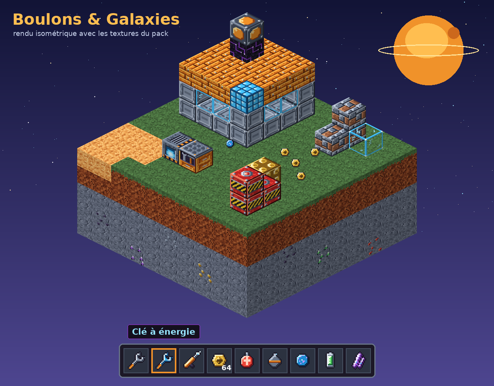
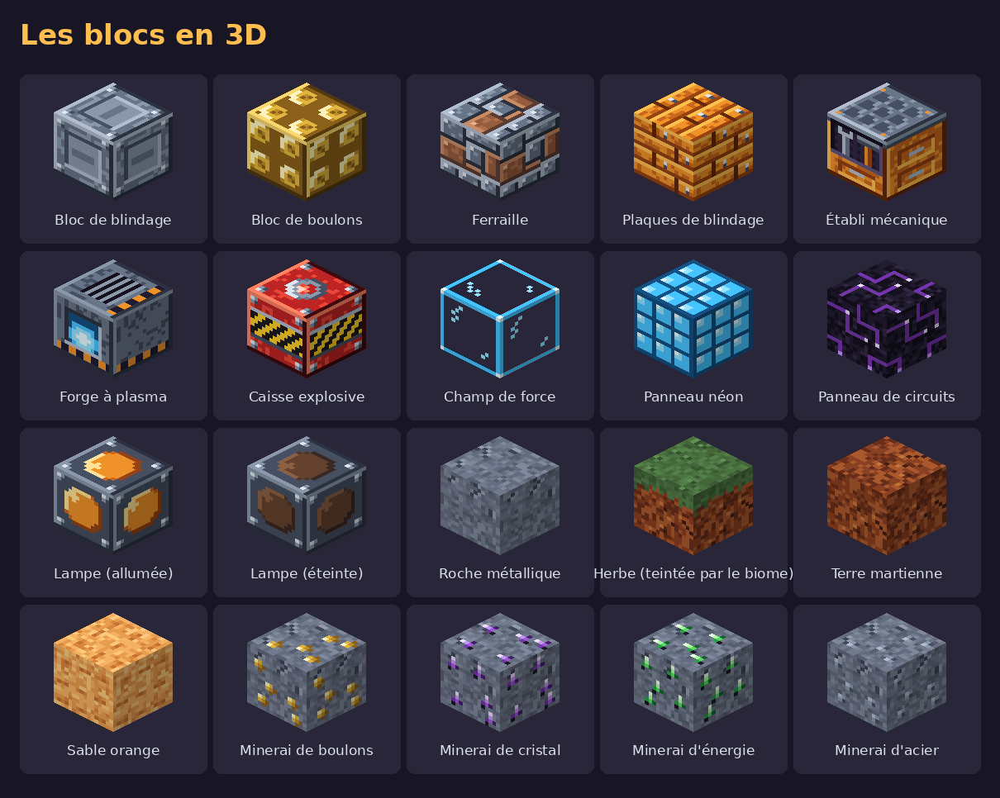
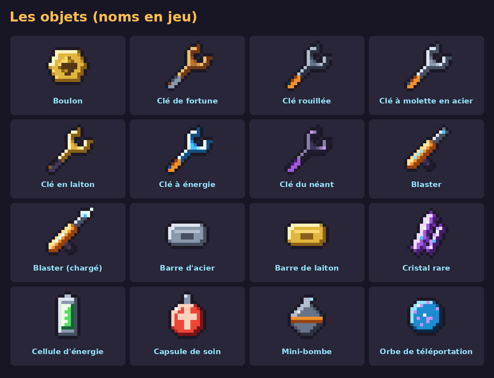
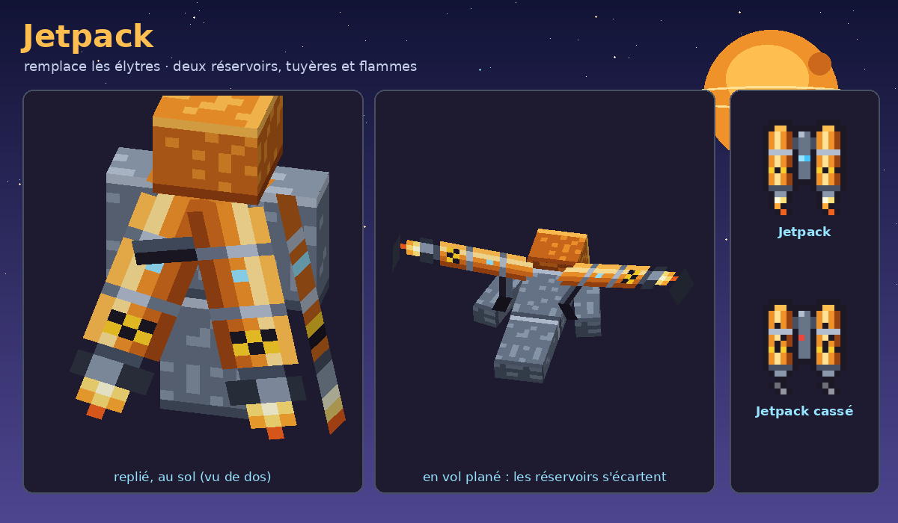
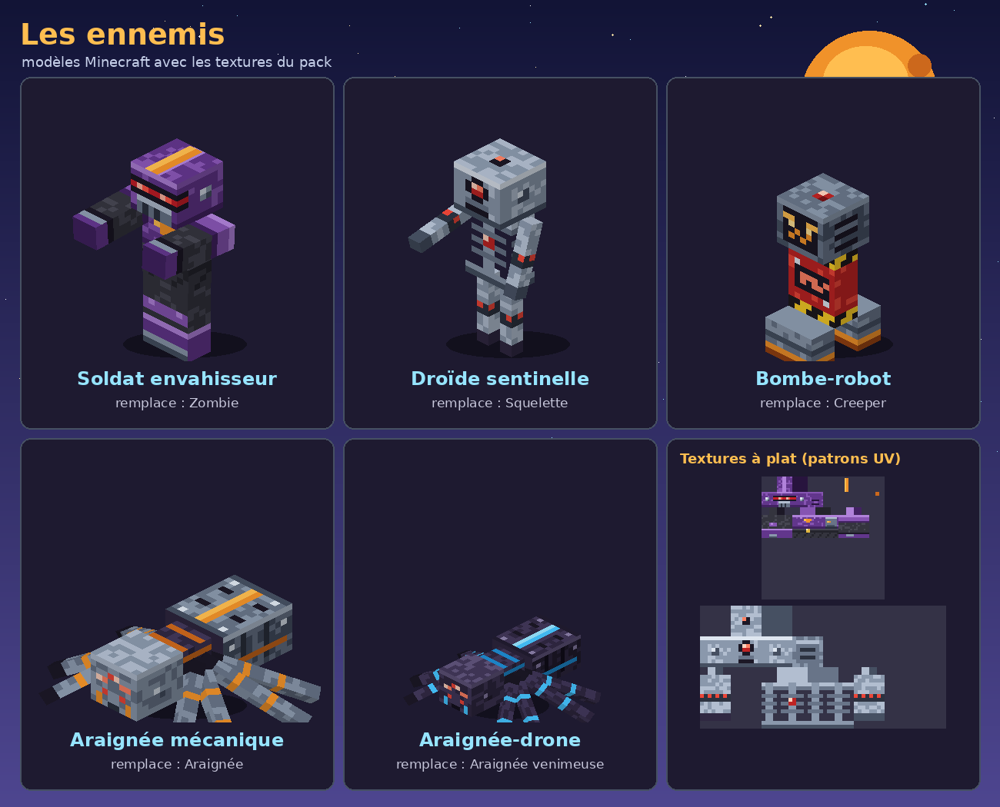
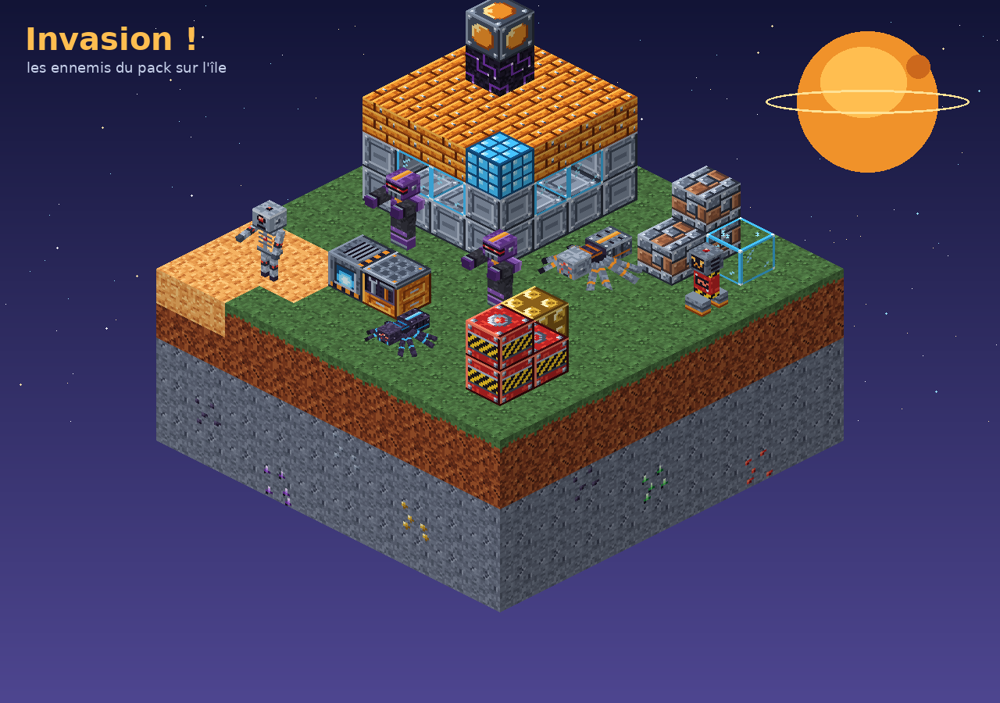
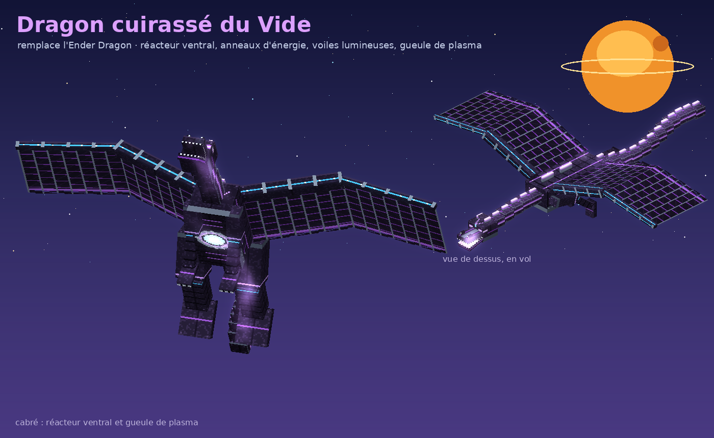
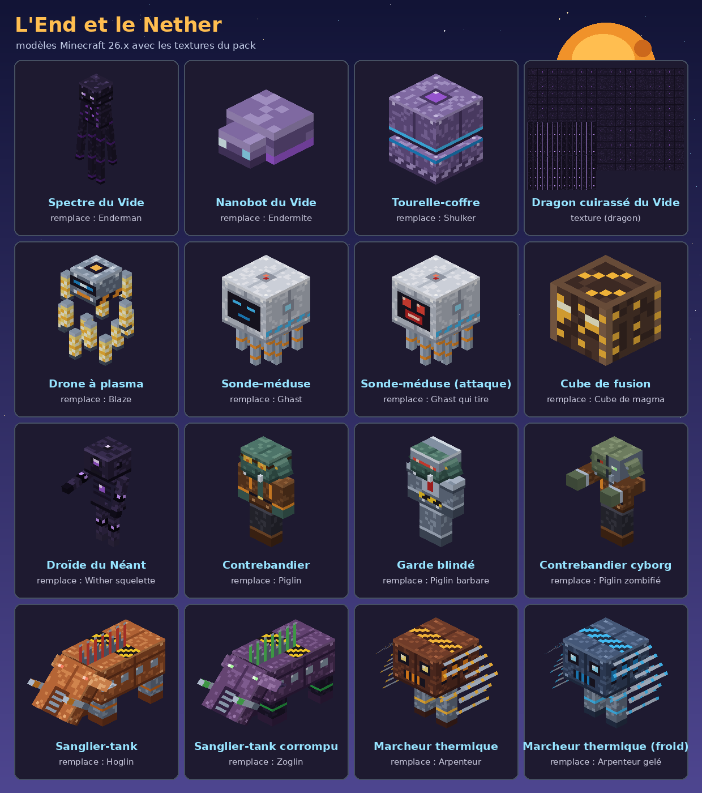
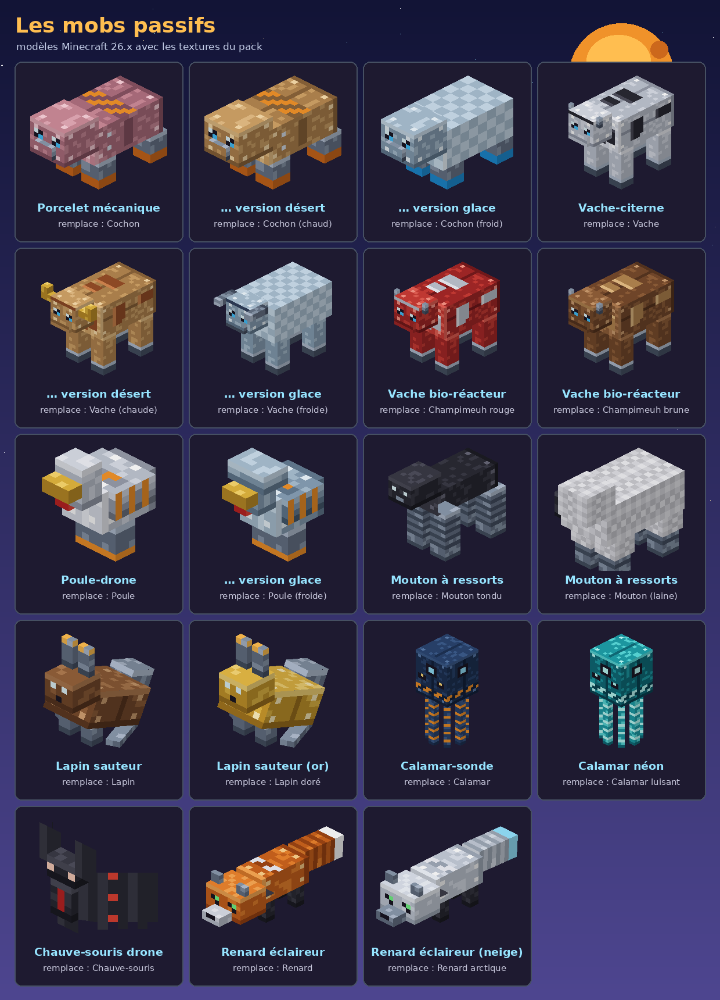

# Boulons & Galaxies : pack de textures Minecraft

Pack de textures **fan-made** pour Minecraft Java Edition, sur un thème sci-fi mécanique et aventure spatiale, **inspiré de l'ambiance de Ratchet & Clank** : boulons comme monnaie, clés à molette comme armes, blasters, blindage riveté, champs de force et planètes désertiques orange.

Toutes les textures sont **originales** et dessinées en pixel art 16×16 par un script Python. Le pack ne contient aucun personnage, logo ni élément graphique officiel de la licence.



| Blocs en 3D | Objets |
|---|---|
|  |  |

### Le jetpack



### Les ennemis




### L'End, le Nether et les mobs passifs





Planche brute de toutes les textures : [preview.png](preview.png). Les rendus sont générés par `generator/render_screens.py` et `generator/render_mobs.py`.

## Installation

1. Télécharger `dist/BoulonsEtGalaxies.zip`.
2. Le copier **sans le décompresser** dans le dossier `.minecraft/resourcepacks/`.
   - Windows : `%appdata%\.minecraft\resourcepacks`
   - macOS : `~/Library/Application Support/minecraft/resourcepacks`
   - Linux : `~/.minecraft/resourcepacks`
3. En jeu : **Options → Packs de ressources**, puis activer « Boulons & Galaxies ».

Versions visées : Minecraft Java **1.20.5 et suivantes** pour les blocs et objets ; les mobs suivent les chemins et la géométrie de **Minecraft 26.x** (testés contre la 26.3). Si une version plus récente affiche « incompatible », le pack fonctionne quand même : il suffit de confirmer.

## Ce qui change

| Vanilla | Devient |
|---|---|
| Pépite d'or | **Boulon** (la monnaie) |
| Épées (bois → netherite) | **Clés à molette** (fortune, rouillée, acier, laiton, énergie, néant) |
| Arc (+ 3 étapes de tension) | **Blaster** qui se charge en énergie |
| Élytres (+ cassées) | **Jetpack** : deux réservoirs, tuyères et flammes ; en vol plané, les réservoirs s'écartent |
| Lingots de fer / d'or | Barres d'acier / de laiton |
| Diamant / Émeraude | Cristal rare / Cellule d'énergie |
| Pomme | Capsule de soin |
| Boule de neige | Mini-bombe |
| Perle de l'Ender | Orbe de téléportation |
| Bloc de fer / d'or | Bloc de blindage riveté / Bloc de boulons |
| Pierre, minerais | Roche métallique bleutée avec boulons, cristaux… |
| Terre, sable, herbe | Sol rouge-orangé de planète désertique |
| Pierre taillée | Ferraille assemblée |
| Planches de chêne | Plaques de blindage orange |
| Établi / Fourneau | Établi mécanique / Forge à plasma |
| TNT | Caisse explosive à bandes de danger |
| Verre | Champ de force |
| Pierre lumineuse, lampe | Panneau néon, projecteur |
| Obsidienne | Panneau de circuits violets |
| Zombie | **Soldat envahisseur** (armure violette, visière rouge, crête orange) |
| Squelette | **Droïde sentinelle** (robot chromé à œil rouge) |
| Creeper | **Bombe-robot** (caisse à bandes de danger, compte à rebours) |
| Araignée | **Araignée mécanique** (yeux rouges lumineux) |
| Araignée venimeuse | **Araignée-drone** (version sombre à néons bleus) |
| Enderman / Endermite | **Spectre du Vide** (yeux violets lumineux) / **Nanobot du Vide** |
| Shulker / Ender Dragon | **Tourelle-coffre** / **Dragon cuirassé du Vide** : dragon-mécha avec réacteur ventral, anneaux d'énergie sur le cou et la queue, voiles d'énergie quadrillées, gueule de plasma — toutes les lignes lumineuses brillent dans le noir ; version « surchauffe » orange pendant sa mort |
| Blaze / Ghast | **Drone à plasma** / **Sonde-méduse** (écran qui passe au rouge quand elle tire) |
| Cube de magma / Wither squelette | **Cube de fusion** / **Droïde du Néant** |
| Piglin / Piglin barbare / Piglin zombifié | **Contrebandier** / **Garde blindé** / **Contrebandier cyborg** |
| Hoglin / Zoglin | **Sanglier-tank** / **Sanglier-tank corrompu** |
| Arpenteur (+ gelé) | **Marcheur thermique** |
| Cochon, vache, poule (3 climats chacun) | **Porcelet mécanique**, **Vache-citerne**, **Poule-drone** |
| Champimeuh rouge / brune | **Vache bio-réacteur** |
| Mouton (+ laine, sous-laine) | **Mouton à ressorts** (laine = fibre isolante, teintable) |
| Lapin (8 variantes) / Renard (4 variantes) | **Lapin sauteur** / **Renard éclaireur** |
| Calamar / Calamar luisant / Chauve-souris | **Calamar-sonde** / **Calamar néon** / **Chauve-souris drone** (sans ailes : caméra rouge, propulseurs, antennes, patin) |

Les noms des objets modifiés sont aussi traduits (fichiers `fr_fr.json` et `en_us.json`).

## Modifier / régénérer le pack

Le pack est entièrement généré par `generator/generate.py` (il a besoin de Python 3 et de Pillow) :

```bash
pip install pillow
```

```bash
python3 generator/generate.py
```

Le script recrée le dossier `pack/`, l'archive `dist/BoulonsEtGalaxies.zip` et `preview.png`. Chaque texture correspond à une fonction du script (`wrench()`, `blaster()`, `iron_block()`…), ce qui facilite les retouches de couleurs ou de formes.

## Structure

```
pack/
├── pack.mcmeta
├── pack.png
└── assets/minecraft/
    ├── lang/            (fr_fr.json, en_us.json)
    └── textures/
        ├── block/       (31 textures)
        └── item/        (18 textures)
```

---
*Projet non officiel, sans lien avec Insomniac Games ou Sony Interactive Entertainment.*
