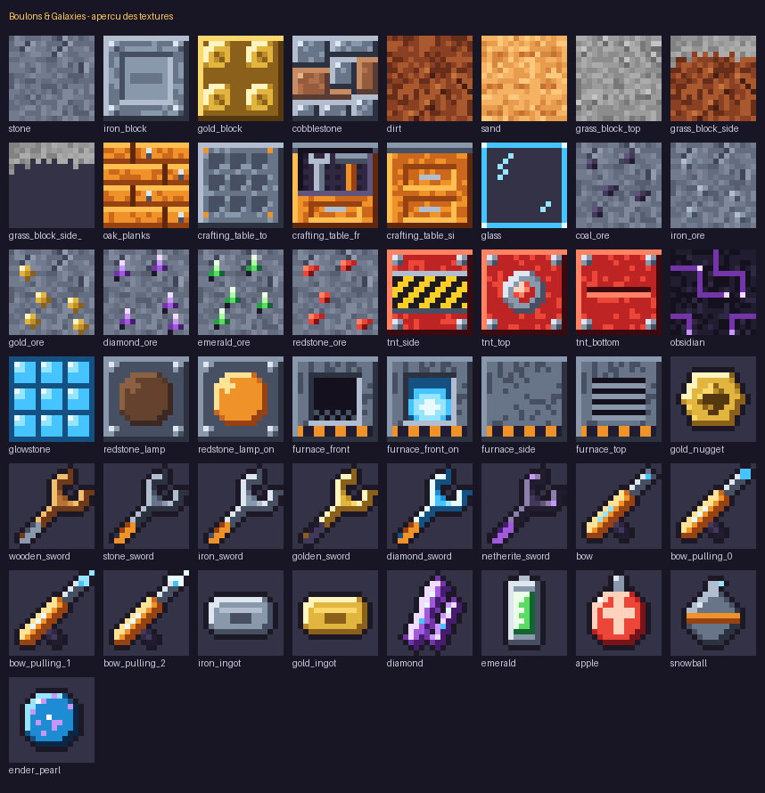

# Boulons & Galaxies : pack de textures Minecraft

Pack de textures **fan-made** pour Minecraft Java Edition, sur un thème sci-fi mécanique et aventure spatiale, **inspiré de l'ambiance de Ratchet & Clank** : boulons comme monnaie, clés à molette comme armes, blasters, blindage riveté, champs de force et planètes désertiques orange.

Toutes les textures sont **originales** et dessinées en pixel art 16×16 par un script Python. Le pack ne contient aucun personnage, logo ni élément graphique officiel de la licence.



## Installation

1. Télécharger `dist/BoulonsEtGalaxies.zip`.
2. Le copier **sans le décompresser** dans le dossier `.minecraft/resourcepacks/`.
   - Windows : `%appdata%\.minecraft\resourcepacks`
   - macOS : `~/Library/Application Support/minecraft/resourcepacks`
   - Linux : `~/.minecraft/resourcepacks`
3. En jeu : **Options → Packs de ressources**, puis activer « Boulons & Galaxies ».

Versions visées : Minecraft Java **1.20.5 et suivantes** (1.21.x). Si une version plus récente affiche « incompatible », le pack fonctionne quand même : il suffit de confirmer.

## Ce qui change

| Vanilla | Devient |
|---|---|
| Pépite d'or | **Boulon** (la monnaie) |
| Épées (bois → netherite) | **Clés à molette** (fortune, rouillée, acier, laiton, énergie, néant) |
| Arc (+ 3 étapes de tension) | **Blaster** qui se charge en énergie |
| Lingots de fer / d'or | Barres d'acier / de laiton |
| Diamant / Émeraude | Cristal rare / Cellule d'énergie |
| Pomme | Capsule de soin |
| Boule de neige | Mini-bombe |
| Perle de l'Ender | Orbe de téléportation |
| Bloc de fer / d'or | Bloc de blindage riveté / Bloc de boulons |
| Pierre, minerais | Roche métallique bleutée avec boulons, cristaux… |
| Terre, sable, herbe | Sol rouge-orangé de planète désertique |
| Pierre taillée | Ferraille assemblée |
| Planches de chêne | Plaques de blindage orange |
| Établi / Fourneau | Établi mécanique / Forge à plasma |
| TNT | Caisse explosive à bandes de danger |
| Verre | Champ de force |
| Pierre lumineuse, lampe | Panneau néon, projecteur |
| Obsidienne | Panneau de circuits violets |

Les noms des objets modifiés sont aussi traduits (fichiers `fr_fr.json` et `en_us.json`).

## Modifier / régénérer le pack

Le pack est entièrement généré par `generator/generate.py` (il a besoin de Python 3 et de Pillow) :

```bash
pip install pillow
```

```bash
python3 generator/generate.py
```

Le script recrée le dossier `pack/`, l'archive `dist/BoulonsEtGalaxies.zip` et `preview.png`. Chaque texture correspond à une fonction du script (`wrench()`, `blaster()`, `iron_block()`…), ce qui facilite les retouches de couleurs ou de formes.

## Structure

```
pack/
├── pack.mcmeta
├── pack.png
└── assets/minecraft/
    ├── lang/            (fr_fr.json, en_us.json)
    └── textures/
        ├── block/       (31 textures)
        └── item/        (18 textures)
```

---
*Projet non officiel, sans lien avec Insomniac Games ou Sony Interactive Entertainment.*
